# DS5 Bridge

  

  
  
  
   
  

  

  <strong>DS5 Bridge 2.0 is live.</strong> 
  A redesigned, translated companion app, Wake-on-LAN from the controller,
  firmware updates confirmed on the controller, and a steadier connection.

  <a href="https://kitsuneinput.com/buy?src=ds5-readme">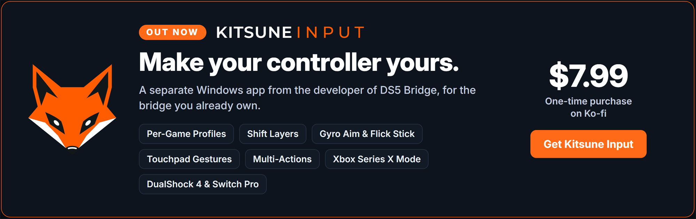</a>

  
  

DS5 Bridge lets you use a real Sony DualSense or DualSense Edge controller
wirelessly on a Windows PC through a Raspberry Pi Pico 2 W or a Waveshare
RP2350B-Plus-W. The controller pairs to the board over Bluetooth, and the board
plugs into your PC over USB.

The companion app gives you a clean place to adjust audio, haptics, trigger
strength, lighting, button remaps, shortcuts, firmware tools, and other
controller behavior without rebuilding firmware.

## Quick Start

1. Download the firmware for your board and the Windows companion installer
   from [Releases](https://github.com/SundayMoments/DS5_Bridge/releases/latest):
   `DS5-Bridge-Firmware-v….uf2` for a Pico 2 W, or
   `DS5-Bridge-Firmware-Waveshare-v….uf2` for a Waveshare RP2350B-Plus-W.
2. With the Pico 2 W unplugged, hold `BOOTSEL`, then connect it to your PC.
3. Copy the `.uf2` file onto the Pico drive that appears in Windows.
4. Briefly press `BOOTSEL` once, then wait about one second for the Pico to open
   its controller pairing window.
5. Put the DualSense controller into Bluetooth pairing mode by holding `Create`
   and `PS` until the lightbar rapidly blinks blue.
6. Wait for the controller to pair to the Pico, not directly to Windows.
7. Install and open DS5 Bridge. The Overview page should show the connected
   bridge and firmware version.

Once the controller connects to the Pico, Windows sees it as a normal
DualSense-compatible USB controller.

## BOOTSEL Button Gestures

After DS5 Bridge firmware is installed, the Pico's `BOOTSEL` button controls
controller connections and firmware maintenance:

| Gesture | Action |
| --- | --- |
| One brief press | If no controller is connected, open the controller pairing window. If a controller is connected, disconnect it while preserving its saved pairing. |
| Two brief presses | Reboot the Pico normally. |
| Three brief presses | Reboot into USB firmware flashing mode. The Pico appears as a drive so you can copy a `.uf2` file onto it. |
| Hold for about 1.5 seconds | Forget all saved controller pairings, disconnect the current controller, and open a fresh pairing window. |

A one- or two-press gesture is performed after the Pico waits about one second
to make sure another press is not coming. For a new controller, briefly press
`BOOTSEL` once, wait for the pairing window to open, then hold `Create` and `PS`
on the controller until its lightbar rapidly blinks blue.

## Features

- Use a DualSense or DualSense Edge wirelessly through a Pico 2 W or a
  Waveshare RP2350B-Plus-W.
- Use the controller speaker, headset jack, microphone, and audio-driven haptics.
- Tune audio, haptics, adaptive triggers, and lighting from the Windows app.
- Use Audio Haptics to turn system or app audio into controller feedback.
- Save controller setups as profiles.
- Remap buttons, set stick deadzones, and assign chord shortcuts.
- See the current and last controllers on the Devices page, and pair or forget
  controllers from there.
- Use more than one bridge and switch between them from the sidebar; each
  keeps its own settings.
- Switch the host persona between DualSense, DualSense Edge, DualShock 4, and Xbox modes.
- See Bluetooth signal quality at a glance.
- Wake a sleeping or shut-down PC by turning on the controller (Wake-on-LAN).
- Mount, flash, or nuke Pico firmware from Settings, confirmed with a button
  sequence on the controller.
- Use the app in several languages.

## Wake PC (Wake-on-LAN)

When your PC sleeps or shuts down, turning on the controller can wake it. The
bridge first tries a normal USB wake, then joins your Wi-Fi and sends a
Wake-on-LAN packet to the PC's Ethernet adapter. The companion app does not
need to be running.

1. In Windows Device Manager, open your Ethernet adapter's properties and
   enable **Wake on Magic Packet** (and, if listed, **Wake on magic packet
   from power off state**). The PC must be wired to the same network.
2. Turn off the controller, then open **Settings > Wake PC** in DS5 Bridge.
3. Enter your Wi-Fi name and password (WPA2), choose your country and the
   Ethernet adapter, and select **Test and save**. The bridge joins the network
   once to check it; the password stays on the bridge and is never shown again.

Only a controller already paired with the bridge can wake the PC; a new
pairing never does. While the bridge uses Wi-Fi, it pauses the controller for
a few seconds.

## Firmware Updates From the App

**Mount**, **Flash**, and **Nuke** ask you to press a short sequence of face
buttons on the connected controller before the Pico enters USB flashing mode,
so no other program on the PC can reflash the bridge. The first time, the app
pairs this PC with the bridge the same way. Three brief `BOOTSEL` presses, or
holding `BOOTSEL` while plugging in the Pico, still work without the app.

## Kitsune Input: Out Now

**Kitsune Input** is a separate Windows app from the developer of DS5 Bridge,
for the bridge you already own. DS5 Bridge stays complete, free, and open
source; Kitsune Input adds:

- Auto-switching per-game profiles
- Shift layers
- Gyro aim and flick stick
- Touchpad gestures
- Multi-actions
- Stick and trigger tuning
- Xbox Series X mode
- Game Bar overlay and keyboard
- Support for DualShock 4 and Switch Pro Controller too

**$7.99, a one-time purchase on Ko-fi.** Your purchase supports the developer
of DS5 Bridge.

**[Get Kitsune Input](https://kitsuneinput.com/buy?src=ds5-readme)** ·
[Learn more](https://kitsuneinput.com/?src=ds5-readme)

  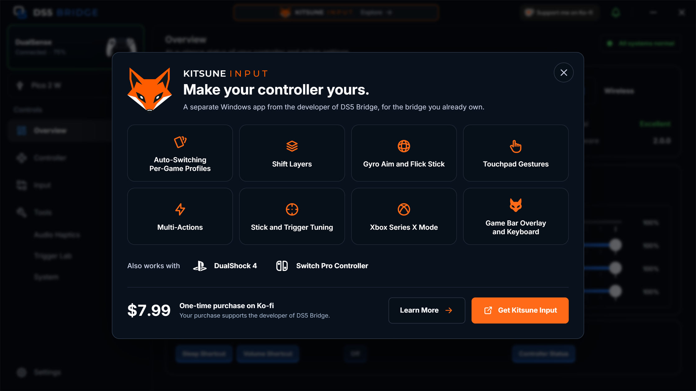

## Companion App Tour

The companion app is where you check the bridge, adjust the controller, and save
the setup you actually want to play with.

The sidebar groups the pages: **Overview**, **Controller** (Devices,
DualSense), **Input** (Stick Deadzones, Button Remapping, Chords), and
**Tools** (Audio Haptics, Trigger Lab, System), with **Settings** at the
bottom. The bridge picker under the controller card switches between bridges.

### Overview

See connection health, firmware version, battery, audio route, Bluetooth signal
quality, and the controls most likely to matter during play. Quick Actions
switch the host persona between DualSense, DualSense Edge, DualShock 4, and
Xbox, or put the controller to sleep.

  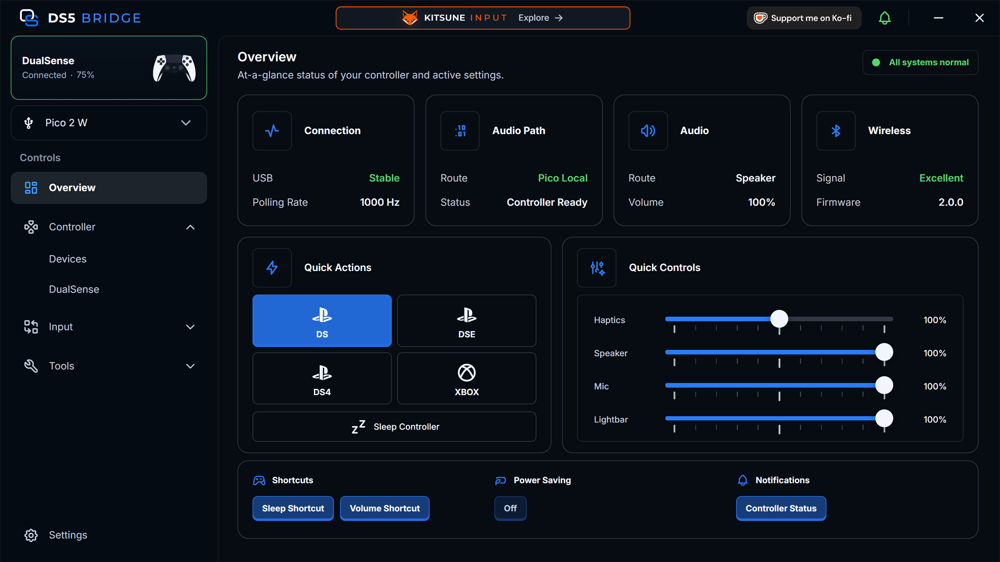

### Devices

See the current and last controllers with their address, pairing, and battery.
Pair a new controller or forget saved ones.

  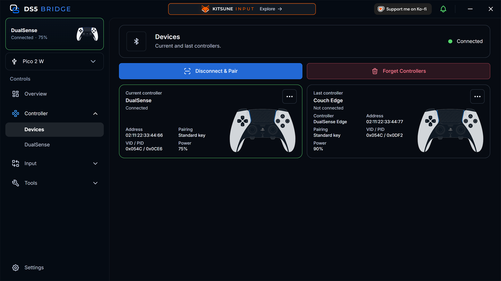

### DualSense

One page with a tab for each part of the controller.

**Audio:** the controller speaker, headphone-jack route, microphone level,
speaker gain, and buffer length.

  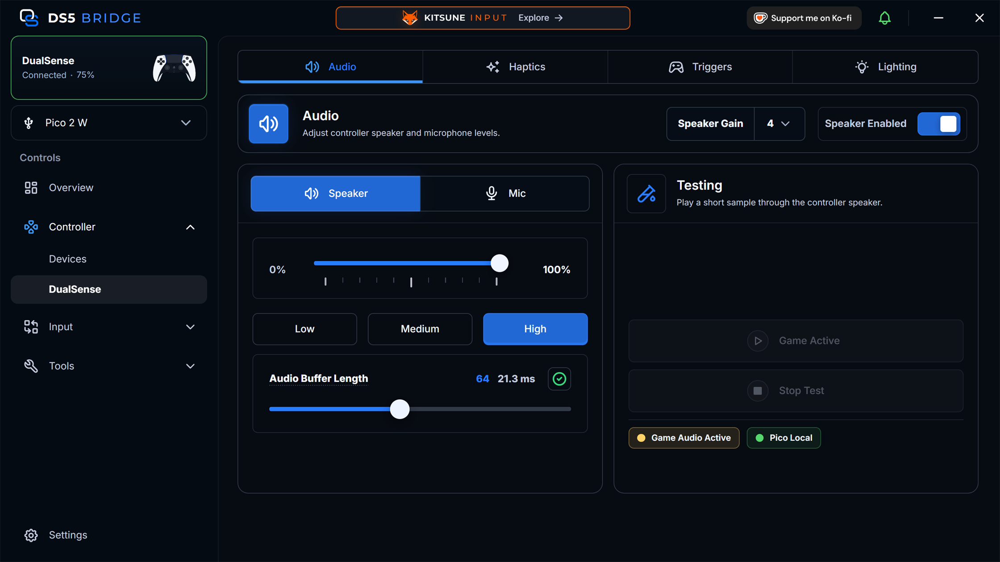

**Haptics:** HD haptics, classic rumble, and feedback boost, with a test to feel
it before opening a game.

  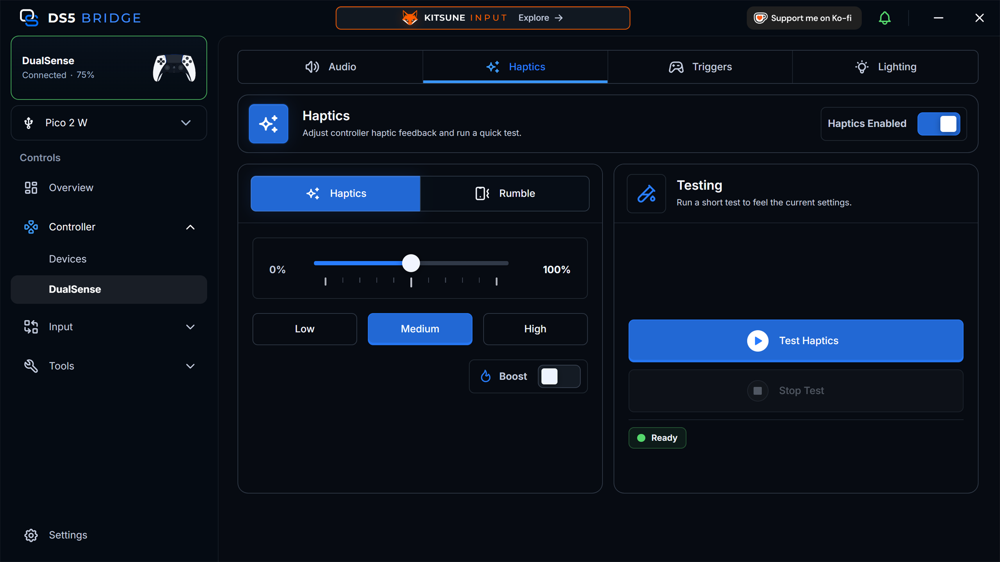

**Adaptive Triggers:** trigger strength and test effects.

  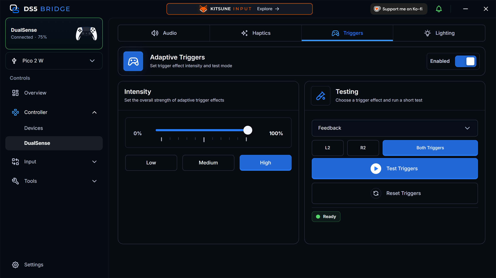

**Lighting:** lightbar brightness and color, or let the app manage the
lightbar.

  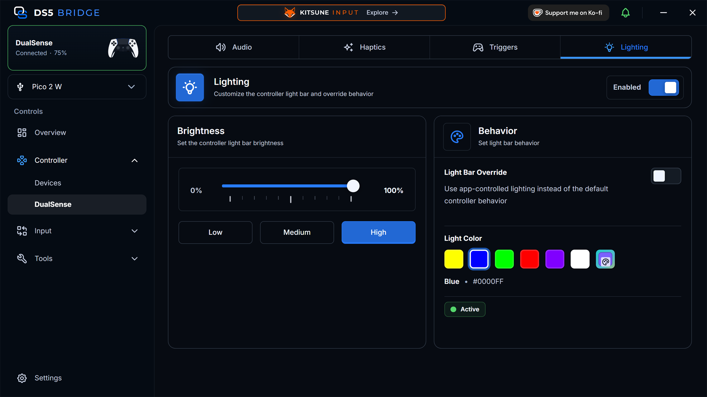

### Stick Deadzones

Remove center drift with an independent radial deadzone for each stick, with a
live view of the raw and adjusted position.

  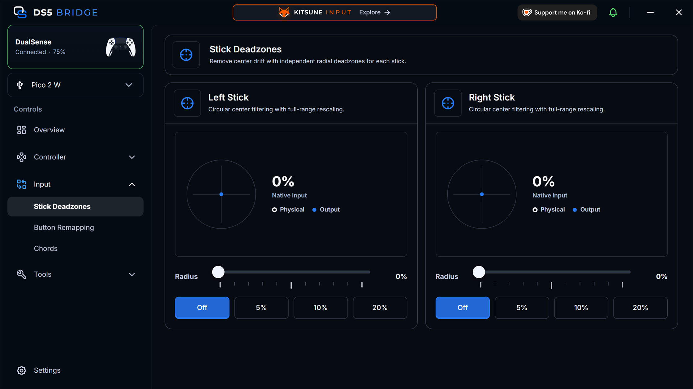

### Button Remapping

Change what each controller button does; changes are saved as you go, and can
be kept as named profiles.

  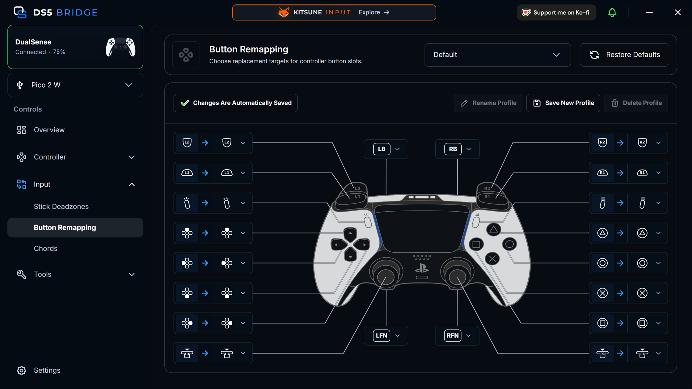

### Chords

Create reusable keyboard, media, and controller actions, then assign them to
PS, LFN, or RFN plus a button.

DualSense Edge reserves LFN/RFN plus the face buttons for onboard profile
switching. Enable **Block Edge Profile Switching** in **Settings > Shortcuts**
to use those combinations as DS5 Bridge chords; turning it off keeps the
assignments saved but inactive.

  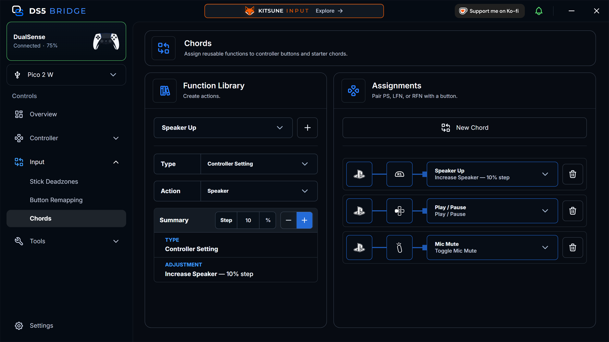

### Audio Haptics

Turn system audio or an app session into controller haptic feedback.

  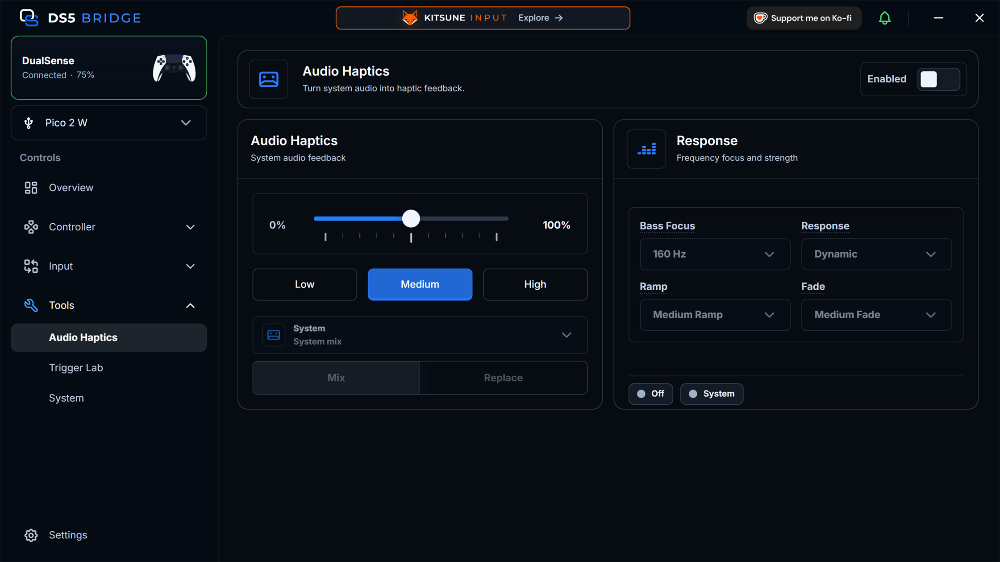

### Trigger Lab

Build and preview adaptive trigger effects for each trigger before applying
them to the controller.

  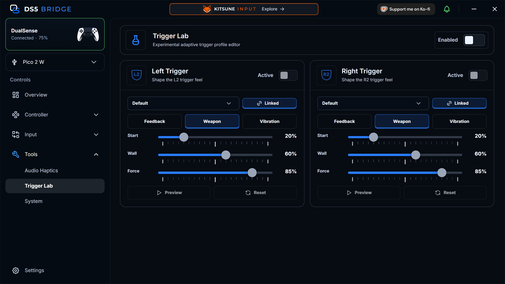

### System

Manage controller profiles, mute button behavior, polling rate, host persona,
diagnostics, and device repair.

  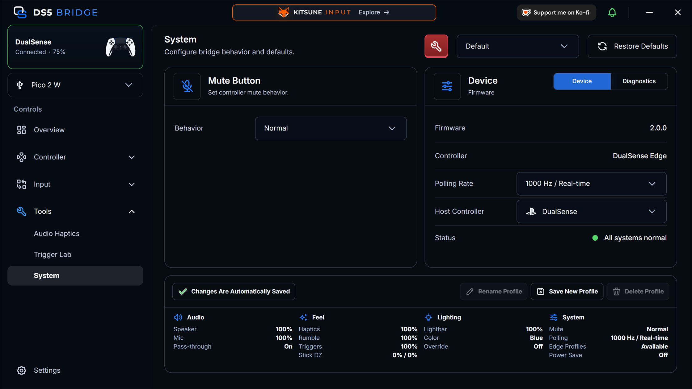

### Settings

Set language, theme, scale, tray and startup behavior, notifications,
connection and power, lights, shortcuts, Wake PC, and bridge firmware. Search
finds any setting by name.

  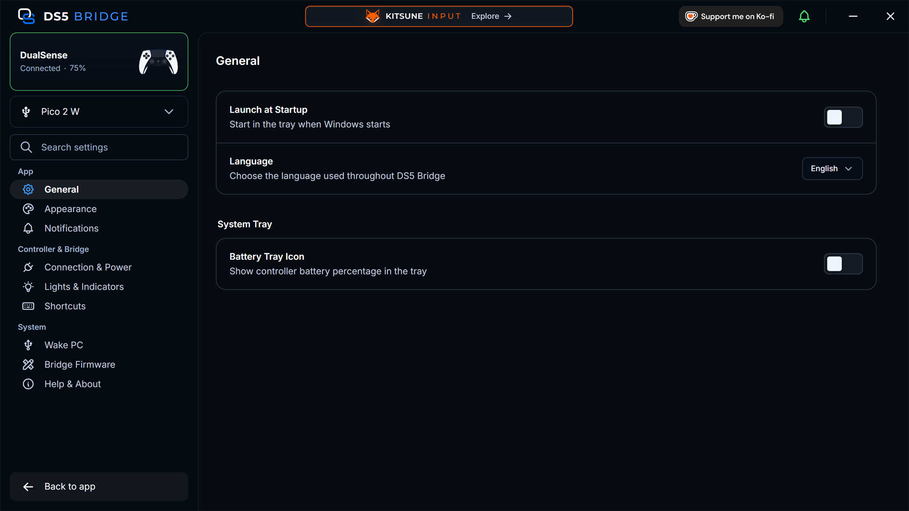

**Wake PC** sets up waking the PC from the controller, over USB or
Wake-on-LAN.

  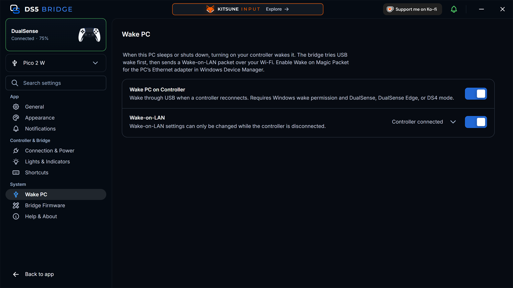

## Troubleshooting

- Use the companion app and firmware from the same release when possible.
- For first-time flashing, hold `BOOTSEL` before plugging the Pico 2 W into the
  PC. The Pico should appear as a USB drive.
- Pair the controller to the Pico, not Windows. Hold `Create` and `PS` until the
  lightbar rapidly blinks blue. If the Pico is not already searching, briefly
  press `BOOTSEL` once and wait about one second first.
- If audio, mic, haptics, or flashing behave oddly, try a direct USB port and a
  data-capable micro-USB cable before using a hub.
- If controller audio sounds doubled, distorted, or too loud, restart your PC,
  reopen DS5 Bridge, and run the speaker test again.
- If Windows keeps stale or duplicate controller/audio devices, use
  [Windows device cleanup](docs/windows-device-cleanup.md) or System >
  Emergency Device Repair.
- Battery level may be inaccurate while the controller is charging.
- If Wake PC does not wake the computer, check that the PC is wired by
  Ethernet, that **Wake on Magic Packet** is enabled for that adapter, and that
  Windows Fast Startup is off if the PC was shut down rather than asleep. The
  bridge only joins 2.4 GHz WPA2 networks.

## Requirements

- Raspberry Pi Pico 2 W or Waveshare RP2350B-Plus-W.
- Sony DualSense or DualSense Edge controller.
- Data-capable USB cable that fits your board (micro-USB on the Pico 2 W).
- Windows for the companion app.

## For Developers

See [docs/development.md](docs/development.md) for local build requirements,
firmware build commands, companion app setup, audio helper notes, and packaging
steps.

## Project Layout

| Path | Purpose |
| --- | --- |
| `src/main.cpp` | Pico startup, watchdog handling, USB task loop, and HID report bridge. |
| `src/bt.cpp` | Bluetooth inquiry, pairing, L2CAP HID channels, and report queueing. |
| `src/audio.cpp` | USB audio ingestion, haptic resampling, Opus speaker encoding, and audio packet assembly. |
| `src/companion.cpp` | Vendor HID companion protocol, status reports, command ACKs, and runtime setting dispatch. |
| `src/usb.cpp` | TinyUSB audio control callbacks and runtime settings fallback. |
| `src/usb_descriptors.c` | USB device, configuration, HID report, audio, and string descriptors. |
| `src/wake_on_lan*.{h,cpp}` | Wake-on-LAN engine, flash store, and the CYW43 Wi-Fi adapter that sends the magic packet. |
| `src/bootloader_*.{h,cpp}` | Controller-confirmed, HMAC-authorized entry into USB flashing mode. |
| `companion/` | Electron companion app source, protocol parser, HID service, assets, and UI. |
| `companion/native/AudioHelper/` | Windows audio helper used by the companion app for audio sessions, haptics mirroring, endpoint setup, and media integrations. |
| `.github/workflows` | CI and release builds. |

## Development Notes

- The bridge presents itself to the host as a standard DualSense-compatible USB
  controller for compatibility.
- The companion app requires firmware built with the companion HID interface
  enabled.
- The project controls runtime behavior through the bridge and does not write
  controller-side profiles.
- Battery level is not reported accurately while the controller is charging.
- During development, Windows may keep stale controller or audio endpoint
  records after descriptor testing. Use
  [docs/windows-device-cleanup.md](docs/windows-device-cleanup.md) only if you
  run into device or endpoint issues while testing.

## License

This repository is distributed as AGPL-3.0-only. See [LICENSE](LICENSE).

This project is derived from [awalol/DS5Dongle](https://github.com/awalol/DS5Dongle),
which is credited in [NOTICE](NOTICE). Third-party submodules and package
dependencies retain their own license terms.

DualSense controller overlay artwork is adapted from
[AL2009man/Gamepad-Asset-Pack](https://github.com/AL2009man/Gamepad-Asset-Pack)
and credited in [NOTICE](NOTICE).

## References

- [awalol/DS5Dongle](https://github.com/awalol/DS5Dongle), the foundation for
  this project.
- [rafaelvaloto/Pico_W-Dualsense](https://github.com/rafaelvaloto/Pico_W-Dualsense)
  for project inspiration.
- [egormanga/SAxense](https://github.com/egormanga/SAxense) for Bluetooth
  haptics proof-of-concept work.
- [Sony DualSense controller documentation](https://controllers.fandom.com/wiki/Sony_DualSense)
  for report structure notes.
- [Paliverse/DualSenseX](https://github.com/Paliverse/DualSenseX) for speaker
  report packet references.
- Alex Smith of The Cynic Project for the speaker test sound, "Crystal Cave"
  (`song18`).
